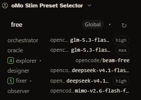

# oMo Slim Preset Selector

[](LICENSE)
[](package.json)

An OpenChamber extension that shows the active **oh-my-opencode-slim** preset and switches it — without the TUI and without editing the config by hand.



- Panel on the right rail and a section in the Work Status panel.
- Shows the active preset, its origin (`Global` / `Project`), and the agent→model mapping of the active preset.
- Dropdown of every preset, with the orchestrator model as a decision hint.
- Confirmation dialog before every switch; cancelling writes nothing.
- Writes **only** the `preset` key. Comments, ordering and formatting of the JSONC file stay intact.
- Checks configured models against the effective model catalog and marks missing ones in red.
- Tracks active and recently finished sessions per agent, with live runtime display.
- Effective after a Managed Service restart (Settings → Apply & Restart).

## Install

1. OpenChamber → Settings → Extensions → Add extension.
2. Enter this repository's URL: `https://github.com/TauNeutrino/openchamber-omo-slim-preset-selector.git`
3. Confirm the requested permissions:
   - `filesystem` for the global config
   - `files` for the project override
   - `sessions` for the per-agent session tracking
   - `service` (`exec: opencode`) for the model catalog check
4. Open the **oMo Slim Preset Selector** panel on the right rail.

Web and desktop clients are supported. The phone app and VS Code do not load extensions.

## Where the config comes from

| Layer | Path |
| --- | --- |
| Global | `~/.config/opencode/oh-my-opencode-slim.json`, else `.jsonc` |
| Project override | `.opencode/oh-my-opencode-slim.json`, else `.jsonc` |

The project map is merged over the global one; the active preset's origin badge shows which layer it comes from.

## Model check

After every load (and then every 15 minutes) the panel checks whether the configured models still exist in the effective catalog. The catalog comes from a small host-managed service that asks `opencode models` (60 s cache, no background load). Missing models are marked red on the agent row and summarized as a warning banner. Unavailable models never crash the switch — the user decides.

## Sessions per agent

Active sessions show a blue circled count badge; sessions that finished within the last 8 hours show a green squared count badge with a live runtime. Each agent row can be expanded to list its sessions (active first, then finished with outcome and relative time). A finished session can be hidden early with the 👁 button; the hide is reset automatically when the session becomes active again.

## Build

```bash
npm install
npm run build   # writes panel/main.js and service/main.js
npm run check   # build + iife + manifest + tests
npm test
npm run type-check
```

The built files are committed: OpenChamber installs extensions without building them. Bump `version` in `package.json` to ship an update through Git.

## Permissions

| Permission | Why |
| --- | --- |
| `files` | Read/write the project override |
| `filesystem` | Read/write the global config |
| `sessions` | Track sub-sessions per agent |
| `service` (`exec: opencode`) | Run `opencode models` for the catalog check |

The extension only ever writes the `preset` key. The presets map, comments, ordering and formatting of the JSONC file are preserved.

## License

MIT

## Support

If you find this extension useful, you can support the development:

[](https://www.paypal.com/donate/?hosted_button_id=R5G9H9TFGQNUY)

[](https://ko-fi.com/O4O01ZCNJE)
EOF
echo written